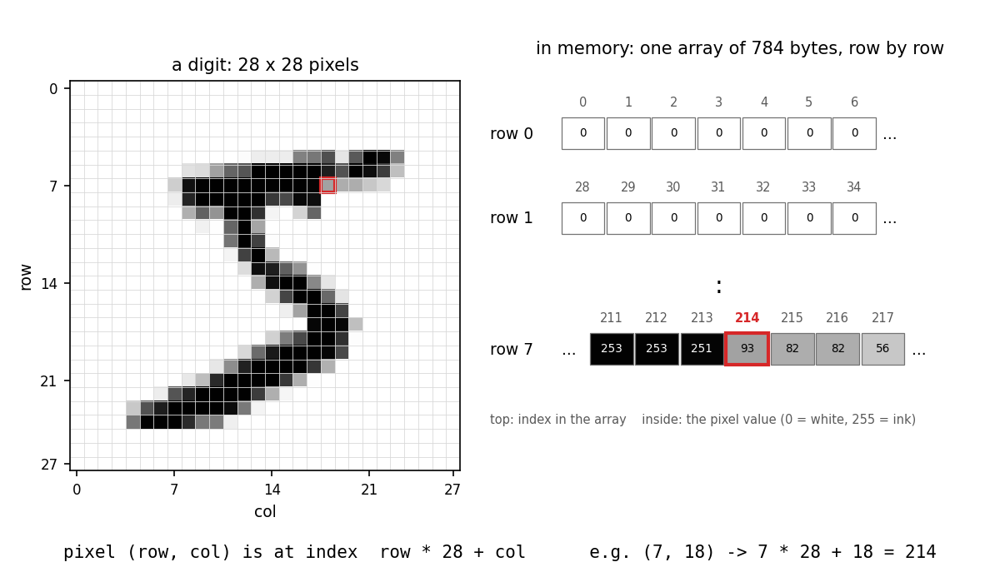
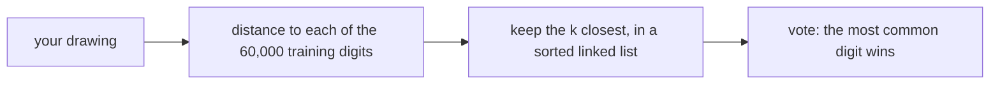

# Homework Assignment 3: A digit reader (due Fri Oct 30th 11:59pm)

You will build a program that **reads handwritten digits**. You draw a digit
in your browser, and your C++ code says which digit it is. It also shows you
*why*: the handwritten digits from its memory that look most like yours.

The method is called **k-nearest neighbors**. It is one of the oldest ideas in
machine learning. To read a new digit, find the $k$ digits in a large
collection of known digits that look most like it, and let them vote. There is
no training step: the program only needs memory, and a good way to search it.

The assignment is worth 100 points: 70 from the autograder, and 30 from a
short report graded by the TAs. If you have questions, come to office hours or
post on `Ed`.

> [!CAUTION]
> Turn off AI autocomplete for this assignment. How to switch it off, in VS
> Code and in other editors:
> [Turn off AI autocomplete](../../labs/lab-01/setup.md#turn-off-ai-autocomplete).
> If you use a chat LLM, you must report it in `llm-usage.txt` (see
> Submission).

**What you write.** You work in the `starter/` folder and write three files
there: `knn.h` (your classes), `knn.cpp` (their methods), and `test_knn.cpp`
(your tests). Do not change anything else in `starter/`. It gives you:

- `mnist.h`: a class that reads the digit files
- `checks.h`: the test harness from Assignment 1, now also counting every
  object made with `new`
- `digits.cpp`, `server.h`, `index.html`: a program that runs your code in the
  terminal and in the browser (the browser needs Linux, macOS or WSL)
- `report-template.md`: the questions of the report

**What you submit.** `knn.h`, `knn.cpp`, `test_knn.cpp`, `report.pdf` and
`llm-usage.txt`.

**How you work.** The assignment is split into six tasks. Each task adds a
small piece, and a test function that checks it. Every task ends the same way:
from `starter/`, compile and run the tests.

```bash
$ g++ -std=c++17 -Wall -Wextra -Werror -g knn.cpp test_knn.cpp -o test_knn
$ ./test_knn
```

If a check fails, the output tells you its line number in `test_knn.cpp`. Do
not start the next task until you see `ALL TESTS PASSED`.

> [!IMPORTANT]
> Before you submit, compile and run `test_knn` one last time: it must print
> `ALL TESTS PASSED`. The autograder runs more checks than these tests, so
> passing them does not guarantee full points. But a test that fails on your
> computer will almost certainly cost points on Gradescope. Fix the earliest
> failing task first: `Classifier` uses your `Image` and `NeighborList`, so a
> bug in Task 1 or Task 3 can also cost points in Tasks 4 and 5.

## The data

The digits come from **MNIST**, a set of 70,000 digits written by American
census workers and high school students in the 1990s. It is the "hello world"
of machine learning.

Each digit is a `28 x 28` grayscale image: 784 pixels. Each pixel is one byte,
from 0 (white paper) to 255 (black ink). In memory, an image is a single
array of 784 bytes, stored **row by row**: first the 28 pixels of row 0, then
the 28 pixels of row 1, and so on. So the pixel at (row, col) is at index
`row * 28 + col`.



### Download the data

The images are not in `starter/`: you download them once, before Task 1.
MNIST comes as four files. Two hold the **training** images (60,000 of them):
an images file with the pixels of every image, and a labels file that says,
for each image, which digit it shows (0 to 9). The other two hold the
**test** images (10,000), in the same two-file format.

Run these four commands inside `starter/`. Each one downloads a compressed
file, unzips it, and saves it under the name the code expects:

```bash
$ curl -L https://ossci-datasets.s3.amazonaws.com/mnist/train-images-idx3-ubyte.gz | gunzip > train-images.idx
$ curl -L https://ossci-datasets.s3.amazonaws.com/mnist/train-labels-idx1-ubyte.gz | gunzip > train-labels.idx
$ curl -L https://ossci-datasets.s3.amazonaws.com/mnist/t10k-images-idx3-ubyte.gz | gunzip > test-images.idx
$ curl -L https://ossci-datasets.s3.amazonaws.com/mnist/t10k-labels-idx1-ubyte.gz | gunzip > test-labels.idx
```

To check that it worked, list the files:

```bash
$ ls -l *.idx
```

You should see four files, and `train-images.idx` should be 47,040,016
bytes: 60,000 images of 784 pixels each, plus a 16-byte header. These files
stay on your computer: do not submit them.

### Read the data: the class `MnistReader`

You do not have to read these files byte by byte. The starter file `mnist.h`
gives you a class, `MnistReader`, that reads them for you, **one image at a
time**. It does not load a whole file into memory. Each call to `next` reads
the next image from the files into an array that you provide. The following
call overwrites that array with the image after it.

- you create a reader with two file names: an images file and its labels file
- `next(pixels, label)` reads the next image: it fills the array `pixels`
  with the 784 pixels of that image, sets `label` to the digit the image
  shows (0 to 9), and returns `true`. When there are no images left, it
  returns `false`
- `count()` returns how many images the files hold
- if a file is missing, or is not an MNIST file, the constructor throws
  `std::runtime_error`

`mnist.h` also defines two constants you will use everywhere: `SIDE` (28, the
width and height of an image) and `PIXELS` (784, the number of pixels in an
image).

Below is an example that reads all 60,000 training images, one image per pass
of the loop:

```cpp
MnistReader reader("train-images.idx", "train-labels.idx");
std::cout << reader.count() << " images\n"; // 60000

unsigned char pixels[PIXELS]; // room for ONE image: 784 pixels
int label;
while (reader.next(pixels, label)) {
    // pixels now holds the current image, and label the digit it shows.
    // The next call overwrites both: copy them if you want to keep them.
}
```

The array `pixels` only ever holds the current image. To keep an image, you
copy it. That is what the `Classifier` does in Task 4: it copies each image it
reads into its own `Image` object.

## How k-nearest neighbors reads a digit

To find the digits that "look most like" yours, the program needs a number
that says how different two images are. Two images of the same digit tend to
have ink in the same places, so compare them pixel by pixel: take the
difference of each pair of pixels, square it, and add everything up.

$$\text{distance}(a, b) = \sum_{i=0}^{783} (a_i - b_i)^2$$

A small distance means the images are alike. Two identical images are at
distance 0. A 1 and a 7 share some ink, so they are closer than a 1 and an 8.

To read a new digit, the program does three steps:



For example, with k = 3: if the three closest training digits are a 7, a 7
and a 1, the answer is 7.

The k closest digits are kept in a short **sorted linked list**, closest
first. Each time the program finds a candidate, it **inserts it in order**. If the
list grows longer than k, the last node, the farthest one, falls off. This
list, and the recursion that maintains it, is the core of the assignment.

> [!IMPORTANT]
> ### Raw pointers, no containers.
>
> As in Assignment 1: **no `std::vector`, `std::list`, `std::map`, or any
> other standard library container, anywhere in `knn.h` or `knn.cpp`.** Pixel
> arrays come from `new[]`, nodes from `new`, and you free them yourself.
> `std::string` is allowed. The autograder checks this first: a submission
> that uses a container scores zero on the code.

### Recursion

Several methods below are marked *recursive*. They must be written with
recursion: no loop over the list.

A recursive method on a linked list follows three patterns:

- the **public** method (for example `add`) keeps a clean interface. It calls
  a **private helper** (for example `insert_r`) that takes a `Node*`, the
  start of the rest of the list
- the helper handles **one node**, and trusts the recursive call to handle the
  rest of the list
- a helper that changes the list **returns the new start of the rest**, and
  the caller links it back in: `p->next = insert_r(p->next, ...)`

> [!IMPORTANT]
> Recursion is only for the short list of neighbors. The 60,000 training
> digits are an array, and you loop over them: 60,000 nested calls would
> overflow the call stack.

## Task 1: An image (20 points)

### Idea

The first class, `Image`, holds one image: its 784 pixels, and its label (the
number it shows). The pixels live in an array on the **heap**, allocated with
`new[]` when the image is created.

An object that owns heap memory needs the **rule of three**:

- a **destructor** that frees the array
- a **copy constructor** that makes a new image with its own array
- an **assignment operator** that copies another image's pixels into this one

Both copies must be **deep copies**: copy the pixels, not the pointer. If you
copied only the pointer, two images would share one array, and when the
second one is destroyed it would free that array a second time.

### Declare

Create `knn.h` with the class below. Copy it exactly: the autograder compiles
its own tests against your header.

```cpp
#ifndef KNN_H
#define KNN_H

#include <string>

#include "mnist.h"

// A 28 x 28 grayscale image of a digit, and the digit it shows.
class Image {
    private:
        unsigned char* m_pixels; // PIXELS values, row by row: 0 white, 255 ink
        int m_label; // 0 to 9, or -1 if not known

    public:
        Image(); // all white, label -1
        Image(const unsigned char* pixels, int label); // copies the pixels
        ~Image();
        Image(const Image& other);
        Image& operator=(const Image& other);

        int label() const;

        // Throw std::out_of_range if row or col is outside 0 .. SIDE - 1.
        unsigned char at(int row, int col) const;
        void set(int row, int col, unsigned char value);
};

#endif
```

### Implement

Create `knn.cpp`. All the methods of all the classes go in this file, none in
the header. (The one exception is the `Node` constructor that Task 3 gives you
inside the header.)

Below is a skeleton of every `Image` method. Replace each `// TODO` with code.

```cpp
#include "knn.h"

#include <climits> // LONG_MAX, used from Task 3
#include <stdexcept>

Image::Image() {
    // TODO: allocate memory, init variables, and set every pixel to 0
}

Image::Image(const unsigned char* pixels, int label) {
    // TODO: allocate memory, init variables, and copy the PIXELS values from `pixels`
}

Image::~Image() {
    // TODO: free the pixels
}

Image::Image(const Image& other) {
    // TODO: allocate memory, init variables, and copy data from other
}

Image& Image::operator=(const Image& other) {
    // TODO: assigning an image to itself: nothing to do, return *this
    // TODO: copy the other image's pixels into ours, and its label.
    //       Both arrays hold PIXELS values: no need to free and reallocate.
    // TODO: return *this
}

int Image::label() const {
    // TODO
}

unsigned char Image::at(int row, int col) const {
    // TODO: throw std::out_of_range if row or col is outside 0 .. SIDE - 1
    // TODO: return the pixel at index row * SIDE + col
}

void Image::set(int row, int col, unsigned char value) {
    // TODO: the same out of range check as at, then write the pixel
}
```

### Test

Create `test_knn.cpp` with the code below. It has the test for this task, and
a `main` that runs it. Each later task gives you one more test function: add
it above `main`, and add a call to it inside `main`.

```cpp
#include "checks.h"
#include "knn.h"

#include <climits>
#include <stdexcept>

// Task 1
static void test_image() {
    checks::Case c("an image");
    Image blank;
    CHECK(blank.label() == -1);
    CHECK(blank.at(0, 0) == 0);
    CHECK(blank.at(27, 27) == 0);

    unsigned char pixels[PIXELS] = {0};
    pixels[0] = 10; // row 0, col 0
    pixels[1 * SIDE + 2] = 200; // row 1, col 2
    Image img(pixels, 7);
    CHECK(img.label() == 7);
    CHECK(img.at(0, 0) == 10);
    CHECK(img.at(1, 2) == 200);
    pixels[0] = 99; // the image has its own copy
    CHECK(img.at(0, 0) == 10);

    img.set(27, 0, 255);
    CHECK(img.at(27, 0) == 255);
    CHECK_THROWS_AS(img.at(28, 0), std::out_of_range);
    CHECK_THROWS_AS(img.at(0, -1), std::out_of_range);
    CHECK_THROWS_AS(img.set(-1, 5, 1), std::out_of_range);

    Image copy(img); // copy constructor
    copy.set(1, 2, 0);
    CHECK(img.at(1, 2) == 200);
    CHECK(copy.label() == 7);

    Image other;
    other = img; // copy assignment
    other.set(0, 0, 0);
    CHECK(img.at(0, 0) == 10);
    CHECK(other.at(27, 0) == 255);
    Image& same = other;
    other = same; // assigned to itself
    CHECK(other.at(27, 0) == 255);

    const long long before = checks::objects_in_use();
    {
        Image a(pixels, 1);
        Image b(a);
        Image d;
        d = a;
    }
    CHECK_ALL_FREED(before);
}

int main(int argc, char** argv) {
    checks::configure(argc, argv);
    std::cout << "running tests\n\n";

    test_image();

    return checks::summary();
}
```

The last block checks for memory leaks. `checks.h` counts every `new` that
has not been freed yet. `CHECK_ALL_FREED(before)` checks that, after the
images inside the braces are destroyed, the count is back to what it was
before them. If a destructor forgets to free its array, it fails.

### Run

Compile and run the tests. Then use the `digits` program to print a real
digit from the training set, as text in your terminal:

```bash
$ g++ -std=c++17 -O2 -DTASK=1 knn.cpp digits.cpp -o digits
$ ./digits show 0
```

`-DTASK=1` tells `digits.cpp` that you have finished Task 1, so it only uses
what you have written so far.

## Task 2: Distance (6 points)

### Idea

Now give an image a way to compare itself with another image: the distance
from the section above. Go through the 784 pixels, take the difference of each
pair, square it, and add it to a sum. Squaring does two things: every
difference counts as positive, and a big difference counts much more than a
small one.

### Declare

Add this method to the `public` part of `Image`, in `knn.h`:

```cpp
        // Image, public:
        // The sum, over all pixels, of the squared difference.
        long distance(const Image& other) const;
```

### Implement

Add it to `knn.cpp`:

```cpp
long Image::distance(const Image& other) const {
    // TODO: for each of the PIXELS pixels: compute the difference as a long,
    //       and add its square to the sum
    // TODO: return the sum
}
```

Compute each difference as a `long`. The pixels are `unsigned char`, which
cannot hold a negative number, and the difference of two pixels can be
negative. The sum is at most $784 \times 255^2$, about 51 million, which a
`long` holds easily.

### Test

The test first compares two small images you can check by hand. Then it reads
the first three training digits with `MnistReader`, and checks two distances
between them. Add it to `test_knn.cpp`, and call it from `main`:

```cpp
// Task 2
static void test_distance() {
    checks::Case c("distance");
    Image a, b;
    CHECK(a.distance(b) == 0);
    a.set(0, 0, 10);
    b.set(0, 0, 13);
    b.set(5, 5, 255);
    CHECK(a.distance(b) == 9 + 255 * 255);
    CHECK(b.distance(a) == a.distance(b));

    MnistReader reader("train-images.idx", "train-labels.idx");
    unsigned char p0[PIXELS], p1[PIXELS], p2[PIXELS];
    int l0, l1, l2;
    reader.next(p0, l0);
    reader.next(p1, l1);
    reader.next(p2, l2);
    Image d0(p0, l0), d1(p1, l1), d2(p2, l2);
    CHECK(d0.label() == 5);
    CHECK(d1.label() == 0);
    CHECK(d0.distance(d1) == 5698302);
    CHECK(d0.distance(d2) == 7690356);
}
```

### Run

Compile and run the tests.

## Task 3: The k best (18 points)

### Idea

The second class, `NeighborList`, is the heart of the program. While the
classifier compares the query with every training digit, this list keeps the
k closest ones found so far.

It is a **singly linked list, sorted by distance**, closest first. Each node
stores three things: the distance, which training image it was (its index in
the training array), and that image's label.

`add` inserts a new node in its sorted place. If the list is now longer than
k, the last node is cut off: it is the farthest, and only the k closest
matter. Here is what happens with k = 3:

```text
add(50)    head -> [50] -> nullptr
add(20)    head -> [20] -> [50] -> nullptr
add(70)    head -> [20] -> [50] -> [70] -> nullptr           full
add(10)    head -> [10] -> [20] -> [50] -> [70] -> nullptr   4 > k: cut
           head -> [10] -> [20] -> [50] -> nullptr
```

A new node with the **same** distance as a node already in the list goes
after it. So among equal distances, the one found first stays.

Two more methods use the list:

- `limit()` returns the distance a new candidate must beat to get into the
  list. When the list is full, that is the distance of its last node. Before
  the list is full, any candidate gets in, so it returns `LONG_MAX`, the
  largest `long` (from `<climits>`). The classifier uses `limit()` to skip
  candidates that would only fall off again.
- `vote()` returns the most common label in the list. If two labels are tied,
  the one with the closest neighbor wins. For example, with a 6 at distance 30
  and an 8 at distance 10, each label has one vote, and the answer is 8.

### Declare

Add the class to `knn.h`, after `Image`. (Task 4 adds `Classifier` after it.)

```cpp
// The k closest training images found so far, closest first.
class NeighborList {
    private:
        struct Node {
            long dist;
            int index; // which training image
            int label; // the digit it shows
            Node* next;
            Node(long d, int i, int l) : dist(d), index(i), label(l), next(nullptr) {}
        };

        Node* m_head;
        int m_k;
        int m_size;

        Node* insert_r(Node* p, long dist, int index, int label);
        Node* trim_r(Node* p, int keep);
        void clear_r(Node* p);
        int votes_r(const Node* p, int label) const;
        const Node* node_at(int i) const;

    public:
        explicit NeighborList(int k);
        ~NeighborList();
        NeighborList(const NeighborList&) = delete;
        NeighborList& operator=(const NeighborList&) = delete;

        int k() const;
        int size() const;
        void clear();

        // Adds a neighbor in order of distance, and keeps only the k closest.
        void add(long dist, int index, int label);

        // The distance a new image must beat to get in: the k-th distance if
        // the list is full, otherwise LONG_MAX.
        long limit() const;

        // The i-th closest, 0 first.  Throw std::out_of_range.
        long distance_at(int i) const;
        int index_at(int i) const;
        int label_at(int i) const;

        // The most common label.  A tie goes to the label of the closest
        // neighbor among the tied ones.  -1 if the list is empty.
        int vote() const;
};
```

The `= delete` lines forbid copying a list. You will never need a copy, and
forbidding it saves you from writing a deep copy for the nodes.

### Implement

Write the methods in three groups. Start with the simple ones:

```cpp
NeighborList::NeighborList(int k) {
    // TODO: Initialize data members
    // TODO: throw std::invalid_argument if k < 1
}

NeighborList::~NeighborList() {
    // TODO: free every node (clear_r, below)
}

void NeighborList::clear() {
    // TODO: free every node, then reset m_head and m_size
}

// k() and size() return m_k and m_size.
```

Next, the four recursive helpers, and `add`, which uses two of them. Each
helper looks at one node `p`, and calls itself on `p->next` for the rest of
the list.

```cpp
// recursive: returns the list starting at p, with a new node inserted in order
NeighborList::Node* NeighborList::insert_r(Node* p, long dist, int index, int label) {
    // TODO: recursive insertion (in order)
}

// recursive: returns the list starting at p, cut after its first `keep` nodes
NeighborList::Node* NeighborList::trim_r(Node* p, int keep) {
    // TODO: starting at p delete all nodes after the first `keep` nodes,
    //       if keep == 0, delete p and everything after it
}

// recursive: frees p and every node after it
void NeighborList::clear_r(Node* p) {
    // TODO: recursive clear
}

// recursive: how many nodes from p to the end have this label
int NeighborList::votes_r(const Node* p, int label) const {
    // TODO: count how many nodes from p to the end have this label
}

void NeighborList::add(long dist, int index, int label) {
    m_head = insert_r(m_head, dist, index, label);
    m_size++;
    // TODO: if m_size > m_k, trim to m_k nodes, and fix m_size
}
```

Finally, the methods that read the list. They are NOT recursive:

```cpp
const NeighborList::Node* NeighborList::node_at(int i) const {
    // TODO: throw std::out_of_range if i is outside 0 .. m_size - 1
    // TODO: walk i steps from m_head, and return that node
}

// distance_at, index_at and label_at: return that field of node_at(i).

long NeighborList::limit() const {
    // TODO: LONG_MAX if the list is not full yet (m_size < m_k)
    // TODO: otherwise the distance of the last node, node_at(m_size - 1)
}

int NeighborList::vote() const {
    // TODO: -1 if the list is empty
    // TODO: the largest votes_r(m_head, label) over the labels 0 to 9
    // TODO: walk the list from the head, and return the label of the first
    //       node whose label has that many votes (the closest of the tied ones)
}
```

### Test

The test builds the list from the Idea section step by step, and checks its
order, `limit()` and `vote()` after each step. At the end it adds 1,000
neighbors to a list of 5 and checks that no node leaks. Add it to
`test_knn.cpp`, and call it from `main`:

```cpp
// Task 3
static void test_neighbors() {
    checks::Case c("the k best");
    NeighborList list(3);
    CHECK(list.k() == 3);
    CHECK(list.size() == 0);
    CHECK(list.limit() == LONG_MAX);
    CHECK(list.vote() == -1);

    list.add(50, 0, 4);
    list.add(20, 1, 9);
    list.add(70, 2, 4);
    CHECK(list.size() == 3);
    CHECK(list.distance_at(0) == 20 && list.index_at(0) == 1);
    CHECK(list.distance_at(1) == 50 && list.index_at(1) == 0);
    CHECK(list.distance_at(2) == 70 && list.index_at(2) == 2);
    CHECK(list.limit() == 70);
    CHECK(list.vote() == 4); // two 4s beat one 9

    list.add(10, 3, 9); // in at the front; 70 falls off
    CHECK(list.size() == 3);
    CHECK(list.index_at(0) == 3);
    CHECK(list.limit() == 50);
    CHECK(list.vote() == 9); // 9, 9, 4

    list.add(50, 4, 1); // ties go after: it falls off
    CHECK(list.index_at(2) == 0);
    CHECK_THROWS_AS(list.index_at(3), std::out_of_range);

    NeighborList tie(2);
    tie.add(30, 0, 6);
    tie.add(10, 1, 8);
    CHECK(tie.vote() == 8); // one each: the closest wins

    list.clear();
    CHECK(list.size() == 0);
    CHECK_THROWS_AS(NeighborList(0), std::invalid_argument);

    const long long before = checks::objects_in_use();
    {
        NeighborList big(5);
        for (int i = 0; i < 1000; i++) {
            big.add((i * 37) % 101, i, i % 10);
        }
        CHECK(big.size() == 5);
    }
    CHECK_ALL_FREED(before);
}
```

### Run

Compile and run the tests.

## Task 4: Read a digit (12 points)

### Idea

Now put the pieces together. The third class, `Classifier`, loads the training
digits into an array of `Image`s. To classify a new image (the **query**), it
empties a `NeighborList`, compares the query with every training image, and
offers each one to the list. Then the list votes:

```text
for each training image i:
    d = distance(query, image i)
    if d < list.limit(): list.add(d, i, label of image i)
answer = list.vote()
```

The training images are an array, so this is a plain loop, not recursion.

### Declare

Add the class to `knn.h`, after `NeighborList`:

```cpp
// Reads digits by comparing them with every training image.
class Classifier {
    private:
        Image* m_train; // an array of m_count images
        int m_count;

    public:
        // Loads the first max_count digits of the two files.
        Classifier(const std::string& images_file, const std::string& labels_file,
                   int max_count);
        ~Classifier();
        Classifier(const Classifier&) = delete;
        Classifier& operator=(const Classifier&) = delete;

        int size() const;
        const Image& image(int i) const; // throws std::out_of_range

        // Fills `out` with the query's out.k() nearest training images, and
        // returns their vote.
        int classify(const Image& query, NeighborList& out) const;
};
```

Copying a `Classifier` would copy 60,000 images (47 MB), almost always by
accident. The `= delete` lines make the compiler reject any copy.

### Implement

Here are the two methods that need care. The constructor reads the digits
with an `MnistReader`, and stores them in an array of `Image`s:

```cpp
Classifier::Classifier(const std::string& images_file, const std::string& labels_file,
                       int max_count)
    : m_train(nullptr), m_count(0) {
    MnistReader reader(images_file, labels_file);
    unsigned char pixels[PIXELS];
    int label = 0;
    // TODO: m_count is the smaller of reader.count() and max_count
    // TODO: m_train = new Image[m_count];     (each one made by Image())
    // TODO: for each i: reader.next(pixels, label), then
    //       m_train[i] = Image(pixels, label);  (your operator=)
}

int Classifier::classify(const Image& query, NeighborList& out) const {
    // TODO: out.clear(), so the same list can be reused for the next query
    // TODO: the loop from the pseudocode above
    // TODO: return out.vote()
}
```

If a file is missing, the `MnistReader` constructor throws
`std::runtime_error`. Do not catch it: let it pass to whoever created the
`Classifier`. The test checks that it does.

The other three methods are short:

- the destructor frees the array with `delete[]`. That also runs the
  destructor of every `Image` in it, so their pixels are freed too
- `size()` returns `m_count`
- `image(i)` throws `std::out_of_range` if `i` is outside 0 .. `m_count` - 1,
  and otherwise returns `m_train[i]`

### Test

The test loads 10,000 training digits, then classifies the first two test
digits, a 7 and a 2, and checks the answer and the closest neighbors found.
Add it to `test_knn.cpp`, and call it from `main`:

```cpp
// Task 4
static void test_classify() {
    checks::Case c("classify");
    Classifier clf("train-images.idx", "train-labels.idx", 10000);
    CHECK(clf.size() == 10000);
    CHECK_THROWS_AS(clf.image(10000), std::out_of_range);
    CHECK_THROWS_AS(Classifier("no-such-file", "train-labels.idx", 10), std::runtime_error);

    MnistReader test("test-images.idx", "test-labels.idx");
    unsigned char pixels[PIXELS];
    int label;
    test.next(pixels, label); // the first test digit, a 7
    Image seven(pixels, label);
    NeighborList list(3);
    CHECK(clf.classify(seven, list) == 7);
    CHECK(list.size() == 3);
    CHECK(list.index_at(0) == 9444 && list.distance_at(0) == 1070766);
    CHECK(list.index_at(1) == 9724 && list.index_at(2) == 1673);

    test.next(pixels, label); // the second, a 2
    Image two(pixels, label);
    CHECK(clf.classify(two, list) == 2);
    CHECK(list.index_at(0) == 1609);
}
```

### Run: the web page

Compile and run the tests. Your reader now works. Build `digits` for Task 4,
read the first test digit with k = 3 in the terminal, and then start the web
page:

```bash
$ g++ -std=c++17 -O2 -DTASK=4 knn.cpp digits.cpp -o digits
$ ./digits classify 0 3
$ ./digits serve
loaded 60000 training digits in 0.4 s
open http://localhost:8080 in your browser (Ctrl-C here to stop)
```

Open `http://localhost:8080` and draw a digit. Under the answer you see the
closest training digits: the reason for the answer, straight from your
`NeighborList`. In Part 2 of the page, the **Find mistakes** button reads
test digits and shows the ones your reader gets wrong.

> [!TIP]
> If the page says the server is not responding, your code crashed: the
> error is in the terminal. `./digits classify` runs the same code without the
> browser, so you can debug it there.

## Task 5: How good is it? (6 points)

### Idea

How often is your reader right? You cannot measure that on the training
digits: each one would find itself, at distance 0. A classifier is measured
on digits it has **never seen**: the 10,000 test digits. Read them, classify
each one, and count how often the answer matches the label. That fraction is
the **accuracy**: 0.95 means 95 out of 100 right.

### Declare

Add this method to the `public` part of `Classifier`:

```cpp
        // Classifier, public:
        // The fraction of the first `count` digits of the two files that
        // classify() reads correctly, with k neighbors.
        double accuracy(const std::string& images_file, const std::string& labels_file,
                        int count, int k) const;
```

### Implement

```cpp
double Classifier::accuracy(const std::string& images_file, const std::string& labels_file,
                            int count, int k) const {
    MnistReader reader(images_file, labels_file);
    NeighborList list(k);
    unsigned char pixels[PIXELS];
    int label = 0;
    // TODO: read up to `count` digits. For each: build an Image, classify it,
    //       and count it as correct if the answer equals its label
    // TODO: return static_cast<double>(correct) / read, or 0 if nothing was read
}
```

The `static_cast<double>` matters: `correct / read` divides two `int`s, which
gives 0 whenever `correct < read`.

### Test

Add it to `test_knn.cpp`, and call it from `main`:

```cpp
// Task 5
static void test_accuracy() {
    checks::Case c("accuracy");
    Classifier clf("train-images.idx", "train-labels.idx", 10000);
    CHECK(clf.accuracy("test-images.idx", "test-labels.idx", 200, 3) == 190.0 / 200);
    CHECK(clf.accuracy("test-images.idx", "test-labels.idx", 200, 1) == 186.0 / 200);
    Classifier few("train-images.idx", "train-labels.idx", 1000);
    CHECK(few.accuracy("test-images.idx", "test-labels.idx", 100, 3) == 82.0 / 100);
}
```

### Run

Compile and run the tests. Then measure your reader on the first 1,000 test
digits, with all 60,000 training digits and k = 3. Build with `-O2`, so the
compiler optimizes your code:

```bash
$ g++ -std=c++17 -O2 -DTASK=5 knn.cpp digits.cpp -o digits
$ ./digits accuracy 60000 1000 3
```

**Write down the time it prints now.** Section 4 of the report compares it
with the time after Task 6. Also keep a copy of this version, so you can
rebuild it later:

```bash
$ cp knn.cpp knn-task5.cpp
```

After Task 6, this command rebuilds that older version as a separate program,
`digits-task5`, so you can time both:

```bash
$ g++ -std=c++17 -O2 -DTASK=5 knn-task5.cpp digits.cpp -o digits-task5
$ ./digits-task5 accuracy 60000 1000 3
```

Fill in sections 2 and 3 of the report at the end, after Task 6. They use the
same command, and Task 6 makes it faster without changing the accuracy.

## Task 6: Stop early (8 points)

### Idea

Most training digits are far from the query, and the list only wants the k
closest. While computing a distance, the sum only grows. So once the running
sum reaches `list.limit()`, this training digit cannot get into the list. There
is no point adding the rest of its pixels: stop, and move on to the next
training digit.

Check the limit once per **row**, after adding its 28 pixels, not after every
pixel. In this example the limit is 1,200,000, and the sum passes it after
row 8, so rows 9 to 27 are skipped:

```text
limit = 1,200,000

after row:   0    1   ...    7          8          ...   27
sum:         0    0      1,150,000  1,236,000            -> past the limit: stop
```

Why once per row? With `-O2`, the compiler turns a plain loop over 28 pixels
into a few instructions that each handle several pixels at once. A test inside
that loop prevents it. We measured all three versions, with 60,000 training
digits:

| ms per test digit | `-O0` | `-O2` |
|---|---:|---:|
| no early stop | 100 | 12.8 |
| stop, checked after every pixel | 52 | 12.1 |
| stop, checked after every row | 45 | 7.8 |

### Declare

Add a second `distance` method to the `public` part of `Image`. It takes the
limit as a second parameter:

```cpp
        // Image, public:
        // The same, but it may stop as soon as the sum reaches `limit`, and
        // then returns a value >= limit.
        long distance(const Image& other, long limit) const;
```

### Implement

```cpp
long Image::distance(const Image& other, long limit) const {
    // TODO: for each row: add the squared differences of its SIDE pixels,
    //       then stop if the sum has reached limit
    // TODO: return the sum
}
```

Then change one line in `classify`: compute the distance with
`query.distance(m_train[i], out.limit())`. The answers do not change. A
training digit that is stopped early gets a distance of at least
`out.limit()`, so it would have failed the `d < out.limit()` check anyway.

### Test

Add it to `test_knn.cpp`, and call it from `main`:

```cpp
// Task 6
static void test_early_stop() {
    checks::Case c("early stop");
    Classifier train("train-images.idx", "train-labels.idx", 3);
    const Image& a = train.image(0);
    const Image& b = train.image(1);
    CHECK(a.distance(b, LONG_MAX) == 5698302); // never reaches the limit
    CHECK(a.distance(b, 5698303) == 5698302);
    CHECK(a.distance(b, 1000000) >= 1000000); // stopped early
    CHECK(a.distance(b, 1) >= 1);
}
```

### Run

Compile and run the tests. The tests of Tasks 4 and 5 must still pass: same
answers, only faster. Then time it again, with the same commands as in
Task 5, and write down the new time.

You are done with the tasks, so from now on build `digits` without `-DTASK`.
It then uses everything you wrote:

```bash
$ g++ -std=c++17 -O2 knn.cpp digits.cpp -o digits
$ ./digits serve
```

## Your tests

The tests above are the ones we thought of. Add one more test function,
`test_your_cases`, to `test_knn.cpp`, and call it from `main`. It needs at
least two checks of your own, and at least one of them must be a case you got
wrong, or expected to get wrong. For example: a tie in `vote()` with k = 4, or
`limit()` on a list that is not full yet.

```cpp
static void test_your_cases() {
    checks::Case c("your cases");
    // TODO
}
```

## The report (30 points)

The report is where you use your reader as a scientist: you run experiments,
and explain what you see. Fill in `report-template.md`. It has six sections,
each worth 5 points, and the TAs grade it. Keep it to about five pages,
screenshots included. Write in your own words: short, specific, and with
numbers from your own runs.

When you are done, export it to PDF (for example with `pandoc`, or by printing
it from any Markdown viewer), and submit it as `report.pdf`.

## Submission and grading

Submit these files to [Gradescope](https://www.gradescope.com/), with these
exact names, as individual files:

- `knn.h`
- `knn.cpp`
- `test_knn.cpp` (with `test_your_cases`)
- `report.pdf`
- `llm-usage.txt`

Your code must compile with no warnings with:

```bash
$ g++ -std=c++17 -Wall -Wextra -Werror knn.cpp test_knn.cpp -o test_knn
```

The autograder compiles its own tests against your `knn.h`. So the public
parts of your classes must match this handout exactly, down to every `const`.
Each part below is all or nothing. Your `knn.cpp` must compile and link on
its own: if it does not, nothing can be graded. If it does, but one part is
missing or declared differently from this handout, you lose only that part's
points, and the rest is still graded.

| part | points |
|---|---:|
| Task 1: an image | 8 |
| Task 1: image copies | 8 |
| Task 1: images free their pixels | 4 |
| Task 2: distance | 6 |
| Task 3: the k best | 14 |
| Task 3: the list frees its nodes | 4 |
| Task 4: read a digit | 12 |
| Task 5: accuracy | 6 |
| Task 6: stop early | 8 |
| **autograder** | **70** |
| report, six sections | 30 |
| **total** | **100** |

The `llm-usage.txt` file should contain the name of the LLM, if you used one,
and a copy of the prompts you entered and the responses you received. If you
did not use an LLM, write "No LLM used".

The MNIST data is by Yann LeCun, Corinna Cortes and Christopher Burges,
shared under the Creative Commons Attribution-Share Alike 3.0 license.

> [!CAUTION]
> Remember, academic integrity is of utmost importance. Any attempts at
> cheating or plagiarism will result in a forfeiture of credit. Potential
> further actions include failing the class or referring the case for
> disciplinary measures.
