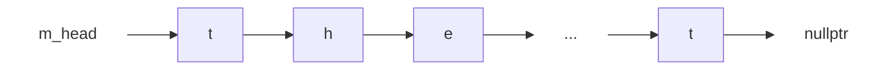
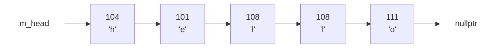
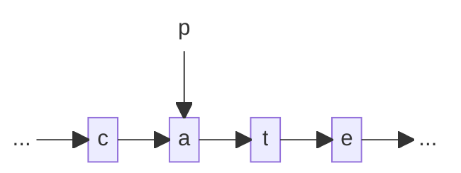
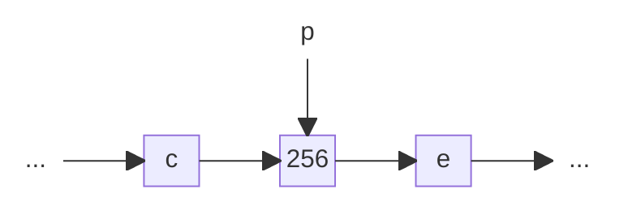
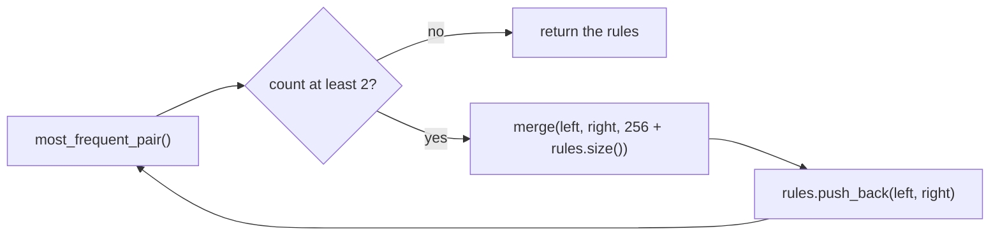

# Lab 06: Linked lists and tokens

Large language models like ChatGPT do not read letters. They read **tokens**:
pieces of text such as `the `, `ing` or `First Citizen:`, each paired with a number.
The pieces are learned from text by an algorithm called **byte pair
encoding** (BPE). Today you will write BPE backed by a singly linked list,
watch it learn pieces of Shakespeare in the browser, and then measure why it
might need a linked list.

> [!CAUTION]
> Turn off AI autocomplete for this lab. How to switch it off,
> in VS Code and in other editors:
> [Turn off AI autocomplete](../lab-01/setup.md#turn-off-ai-autocomplete).

Work in `starter/`. It holds files you do not change: `check.h` (a small test
harness), `bpe.cpp` and `tiny.txt` (Task 5), `bench.cpp`,
`vector_tokens.h` and `shakespeare.txt` (Task 6), and `answers.md`. You create
three files there: `tokens.h`, `tokens.cpp`, and `test_tokens.cpp`.

Every task ends the same way. Compile and run:

```bash
$ cd starter
$ g++ -std=c++17 -Wall -Wextra -g tokens.cpp test_tokens.cpp -o test_tokens
$ ./test_tokens
```

A failing check prints its line number. Do not start the next task until you
see `ALL TESTS PASSED`.

## BPE in one minute

Start with one token per character. Then repeat the following steps:

1. **count** every pair of neighbors, and find the pair that appears most often
2. **merge**: replace every copy of that pair with one new token

Here is a trace of the algorithm on `the cat ate the hat` (spaces shown as `_`):

```text
start                        t h e _ c a t _ a t e _ t h e _ h a t       19 tokens
merge 1:  a + t    -> at     t h e _ c [at] _ [at] e _ t h e _ h [at]    16 tokens
merge 2:  e + _    -> e_     t h [e_] c [at] _ [at] [e_] t h [e_] h [at] 13 tokens
merge 3:  h + e_   -> he_    t [he_] c [at] _ [at] [e_] t [he_] h [at]   11 tokens
merge 4:  t + he_  -> the_   [the_] c [at] _ [at] [e_] [the_] h [at]      9 tokens
```

Frequent pieces of text become single tokens. A merged token can be merged
again: `the_` is built from `t` and `he_`, which is built from `h` and `e_`.

Each new token gets the next free number. Characters are 0 to 255 (`'a'` is
97, `' '` is 32), so the first new token is 256, then 257, and so on. Each one
is saved as a **rule**: `256 = 97 + 116` means "token 256 is `a` followed by
`t`".

## Why a linked list

Every merge **removes one token from the middle** of the sequence, once per
copy of the pair. Real texts have millions of characters, and one merge can
remove tens of thousands of tokens.

- in a `std::vector`, removing one element shifts every element after it one
  slot to the left: $O(n)$ per removal
- in a linked list, removing the node after `p` changes one pointer:
  $O(1)$ per removal



Your list keeps one node per token. A merge walks the list once, and at each
match it **overwrites** the left node and **deletes** the right one.

## Task 1: A list of tokens

The list starts with one node per character of the text. Each node holds one
token number and a pointer to the next node. Here is
`TokenList list("hello");`, with `m_size = 5`:



A `char` is a small number already: `'h'` is 104. To turn it into a token in
the range 0 to 255, write `static_cast<unsigned char>(c)`, which casts the `char` 
to an `unsigned char`.

The class has no `push_back` and no tail pointer. The constructor builds the
list with a local pointer `last` to the node it added most recently.

### Declare

Create `tokens.h`:

```cpp
#ifndef TOKENS_H
#define TOKENS_H

#include <cstddef>
#include <string>
#include <vector>

class TokenList {
    private:
        struct Node {
            int   token;
            Node* next;
            Node(int t) : token(t), next(nullptr) {}
        };

        Node*  m_head;   // the first token, or nullptr
        size_t m_size;   // number of nodes

    public:
        explicit TokenList(const std::string& text);
        ~TokenList();
        TokenList(const TokenList&) = delete;  // no copies
        TokenList& operator=(const TokenList&) = delete; // no assignments

        size_t size() const;
        std::vector<int> tokens() const;
};

#endif
```

> [!NOTE]
> `= delete` turns off copying. A copy would share the same nodes, and both
> destructors would delete them. This lab never needs a copy.

### Implement

Create `tokens.cpp`:

```cpp
#include "tokens.h"

TokenList::TokenList(const std::string& text) {
    m_head = nullptr;
    m_size = 0;
    Node* last = nullptr;
    for (char c : text) {
        // TODO: make a new Node holding static_cast<unsigned char>(c)
        // TODO: push back the new node into the list, and update last
        //       to point to the last node in the list
        // TODO: add 1 to m_size
    }
}

TokenList::~TokenList() {
    // TODO: while m_head is not nullptr:
    //       delete the current node and move m_head to the next node
}

size_t TokenList::size() const {
    // TODO: return the current number of nodes
}

std::vector<int> TokenList::tokens() const {
    std::vector<int> out;
    // TODO: walk the list from m_head to nullptr, push back each token onto out
    return out;
}
```

### Test

Create `test_tokens.cpp`:

```cpp
#include <stdexcept>
#include <string>
#include <vector>

#include "check.h"
#include "tokens.h"

static void test_list() {
    section("task 1: a list of tokens");
    const long long before = nodes_in_use();
    {
        TokenList list("hello");
        CHECK(list.size() == 5);
        CHECK(nodes_in_use() == before + 5);          // one node per character
        CHECK(list.tokens() == std::vector<int>({104, 101, 108, 108, 111}));

        TokenList empty("");
        CHECK(empty.size() == 0);
        CHECK(empty.tokens().empty());
    }
    CHECK(nodes_in_use() == before);                  // the destructor freed them
}

int main() {
    std::cout << "running tests\n";
    test_list();
    return summary();
}
```

`nodes_in_use()` comes from `check.h`. It counts the objects made with `new`
and not deleted yet. The `{ }` braces end the life of both lists, so their
destructors run before the last check.

Compile, run, and answer **Q1** in `answers.md`.

## Task 2: The most frequent pair

To count pairs, walk the list with a temporary pointer `p` and look at `p` and `p->next`
together. Stop when `p->next` is `nullptr`: the last node has no right
neighbor.

```text
m_head -> [a] -> [b] -> [c] -> [a] -> [b] -> [c] -> [a] -> [b] -> nullptr

pairs:     ab     bc     ca     ab     bc     ca     ab           ab 3, bc 2, ca 2
```

The answer is a `Pair`: the left token, the right token, and the count. When
two pairs have the same count, the **smaller** pair wins: compare the left
tokens first, then the right ones. This makes every run give the same rules.

### std::map in one minute

`std::map<K, V>` from the STL stores values by key. Here the key is a pair of
tokens and the value is a count:

| code | does |
|---|---|
| `std::map<std::pair<int, int>, int> counts;` | an empty map |
| `counts[{a, b}]++;` | adds 1 to the count of `(a, b)`; a new key is created at 0 first, so it becomes 1 |
| `for (const auto& [key, count] : counts)` | visits every entry, **smallest key first** |
| `key.first`, `key.second` | the two tokens of the key |

Because the loop visits keys in order, keep a pair only when its count is
**strictly greater** than the best so far. Then the smallest pair wins ties.

### Declare

In `tokens.h`, add this above the class:

```cpp
// Two neighbor tokens, and how many times they appear side by side.
struct Pair {
    int left;
    int right;
    int count;
};
```

and add to the `public:` section:

```cpp
        Pair most_frequent_pair() const;
```

### Implement

Add `#include <map>` and `#include <utility>` to the top of `tokens.cpp`, and:

```cpp
Pair TokenList::most_frequent_pair() const {
    std::map<std::pair<int, int>, int> counts;
    // TODO: walk the list with p, while p and p->next are not nullptr:
    //       add 1 to counts[{p->token, p->next->token}]

    Pair best = {-1, -1, 0};    // no pair yet
    // TODO: for each [key, count] in counts:
    //       if count > best.count, best becomes {key.first, key.second, count}
    return best;
}
```

### Test

Add this test, and call it from `main`:

```cpp
static void test_pairs() {
    section("task 2: the most frequent pair");
    TokenList list("abcabcab");
    Pair p = list.most_frequent_pair();               // ab 3, bc 2, ca 2
    CHECK(p.left == 'a' && p.right == 'b' && p.count == 3);

    TokenList tie("hello");                           // he el ll lo: 1 each
    p = tie.most_frequent_pair();
    CHECK(p.left == 'e' && p.right == 'l' && p.count == 1);   // smallest pair wins

    TokenList one("x");
    CHECK(one.most_frequent_pair().count == 0);       // no pairs at all
    TokenList none("");
    CHECK(none.most_frequent_pair().count == 0);
}
```

Compile, run, and answer **Q2**.

## Task 3: Merge

`merge(left, right, new_token)` walks the list once with a pointer `p`. When `p` holds `left`
and `p->next` holds `right`, it merges the two nodes into one.

Think of it as: **two nodes become one**. The left node stays where it is and
takes the new token. The right node is cut out of the list.

Before `merge('a', 't', 256)`, with `p` on the `'a'` node:



After:



Four lines of code get you there:

| code | what it does |
|---|---|
| `p->token = new_token;` | the `'a'` node becomes 256 |
| `Node* gone = p->next;` | remember the `'t'` node, so you can free it later |
| `p->next = gone->next;` | 256 now points to `'e'`: the `'t'` node is out of the list |
| `delete gone;` | free the `'t'` node |

Only `p` changes, and the node after `p` is freed. No other node moves. That
is $O(1)$ for each pair merged, however long the list is. Then `p` moves on to `p->next`, 
the node after the merged one. Matches do not
overlap: on `aaa`, merging `a + a` gives `[aa] [a]`, not two merges.

`merge` returns how many nodes it removed.

### Declare

Add to the `public:` section of `tokens.h`:

```cpp
        size_t merge(int left, int right, int new_token);
```

### Implement

```cpp
size_t TokenList::merge(int left, int right, int new_token) {
    size_t removed = 0;
    Node* p = m_head;
    while (p != nullptr && p->next != nullptr) {
        // TODO: if p holds left and p->next holds right:
        //       write the new_token into the node pointed by p,
        //       then delete the node after p, update m_size and removed
        // TODO: move p to the next node
    }
    return removed;
}
```

### Test

Add this test, and call it from `main`:

```cpp
static void test_merge() {
    section("task 3: merge");
    TokenList list("abcabcab");
    const long long before = nodes_in_use();
    size_t removed = list.merge('a', 'b', 256);
    CHECK(removed == 3);
    CHECK(nodes_in_use() == before - 3);              // the removed nodes were freed
    CHECK(list.size() == 5);
    CHECK(list.tokens() == std::vector<int>({256, 'c', 256, 'c', 256}));

    CHECK(list.merge(256, 'c', 257) == 2);            // merge a merged token again
    CHECK(list.tokens() == std::vector<int>({257, 257, 256}));

    CHECK(list.merge('x', 'y', 258) == 0);            // not there: nothing changes
    CHECK(list.size() == 3);

    TokenList three("aaa");
    CHECK(three.merge('a', 'a', 256) == 1);           // left to right, no overlap
    CHECK(three.tokens() == std::vector<int>({256, 'a'}));

    TokenList four("aaaa");
    CHECK(four.merge('a', 'a', 256) == 2);
    CHECK(four.tokens() == std::vector<int>({256, 256}));
}
```

Compile, run, and answer **Q3**.

## Task 4: Decode, with a stack

A token number alone is not text. To get the text back, we need to decode
it, in other words, follow its rule. The
rules are kept in a `std::vector<Rule>`, where `Rule` is 
a struct with two `int` members: `left` and `right`. The first element
in the vector, `rules[0]`, is the rule for token 256,
`rules[1]` for token 257, and so on. In general, token `t` uses
`rules[t - 256]`. We don't need to store rules for single characters,
as they use their own character values (0 - 255).

The parts of a rule can be merged tokens too, with rules of their own. So
decoding one token means breaking it into parts, and those parts into parts,
until only characters are left. We can do this with a `std::stack`.

Start with a stack that holds only the token to decode, and an empty text.
Then, while the stack is not empty, pop the top token `t`:

- if `t < 256`, it is one character: add it to the end of the text
- otherwise, look up its rule and put its two parts on the stack:
  push its **right** part, then its **left** part

The left part is pushed last so that it comes out first: the text is built
from left to right. Here is `decode_token(259)`:

```text
rules: 256 = 'a' + 't', 257 = 'e' + ' ', 258 = 'h' + 257, 259 = 't' + 258
```

| step | pop | what it is | push | stack after, top last | text |
|---|---|---|---|---|---|
| start | | | `259` | `259` | `""` |
| 1 | `259` | `'t' + 258` | `258`, then `'t'` | `258` `'t'` | `""` |
| 2 | `'t'` | a character | | `258` | `"t"` |
| 3 | `258` | `'h' + 257` | `257`, then `'h'` | `257` `'h'` | `"t"` |
| 4 | `'h'` | a character | | `257` | `"th"` |
| 5 | `257` | `'e' + ' '` | `' '`, then `'e'` | `' '` `'e'` | `"th"` |
| 6 | `'e'` | a character | | `' '` | `"the"` |
| 7 | `' '` | a character | | empty | `"the "` |

### Declare

In `tokens.h`, add this below `Pair`:

```cpp
// The rule for one new token: left followed by right.
// rules[0] makes token 256, rules[1] makes token 257, and so on.
struct Rule {
    int left;
    int right;
};
```

and add these below the class, before `#endif`:

```cpp
// The text of one token. Uses a stack.
std::string decode_token(int token, const std::vector<Rule>& rules);

// The text of a whole list of tokens.
std::string decode(const std::vector<int>& tokens, const std::vector<Rule>& rules);
```

### Implement

Add `#include <stack>` and `#include <stdexcept>` to the top of
`tokens.cpp`, and:

```cpp
std::string decode_token(int token, const std::vector<Rule>& rules) {
    std::string text;
    std::stack<int> todo; // tokens still to decode, the next one on top
    todo.push(token);
    while (!todo.empty()) {
        int t = todo.top();
        todo.pop();
        // TODO: if t < 256, it is one character: add static_cast<char>(t) to text
        // TODO: otherwise:
        //       calculate index i in rules for this token
        //       if i >= rules.size(), throw std::out_of_range("no rule for this token")
        //       push rules[i].right, then rules[i].left
    }
    return text;
}

std::string decode(const std::vector<int>& tokens, const std::vector<Rule>& rules) {
    std::string text;
    // TODO: for each token, add the result of decode_token(token, rules) to text
    return text;
}
```

### Test

Add this test, and call it from `main`:

```cpp
static void test_decode() {
    section("task 4: decode");
    std::vector<Rule> rules = {{'t', 'h'}, {256, 'e'}, {257, ' '}};
    CHECK(decode_token('A', rules) == "A");           // one character
    CHECK(decode_token(256, rules) == "th");
    CHECK(decode_token(258, rules) == "the ");
    CHECK(decode({258, 'c', 'a', 't'}, rules) == "the cat");
    CHECK(decode({}, rules) == "");
    CHECK_THROWS(decode_token(259, rules), std::out_of_range);
}
```

Compile, run, and answer **Q4**.

## Task 5: Train, and watch it

Now put the pieces together. `train(list, num_merges)` runs BPE: count, merge,
save the rule, and again, `num_merges` times. It stops early when the best
pair appears fewer than 2 times: merging a pair that appears once saves
nothing.



### Declare

Add to `tokens.h`, below `decode`:

```cpp
// BPE: merge the most frequent pair, num_merges times. Returns the rules.
std::vector<Rule> train(TokenList& list, int num_merges);
```

### Implement

Add to `tokens.cpp`:

```cpp
std::vector<Rule> train(TokenList& list, int num_merges) {
    std::vector<Rule> rules;
    for (int i = 0; i < num_merges; i++) {
        Pair best = list.most_frequent_pair();
        // TODO: if best.count < 2, stop the loop (break)
        int new_token = 256 + static_cast<int>(rules.size());
        // TODO: merge best.left and best.right into new_token
        // TODO: push {best.left, best.right} onto rules
    }
    return rules;
}
```

### Test

Add this test, and call it from `main`:

```cpp
static void test_train() {
    section("task 5: train");
    TokenList list("abcabcab");
    std::vector<Rule> rules = train(list, 10);
    CHECK(rules.size() == 2); // then no pair repeats
    CHECK(rules[0].left == 'a' && rules[0].right == 'b');
    CHECK(rules[1].left == 'c' && rules[1].right == 256);
    CHECK(list.tokens() == std::vector<int>({256, 257, 257}));
    CHECK(decode(list.tokens(), rules) == "abcabcab");

    std::string text = "the cat sat on the mat, the cat ate the hat";
    TokenList big(text);
    rules = train(big, 20);
    CHECK(big.size() < text.size());
    CHECK(decode(big.tokens(), rules) == text); // the round trip
}
```

The last check is the most important one: decoding the tokens after training
must give back the text **exactly**. If merge loses or breaks a node, this
fails.

Compile and run until you see `ALL TESTS PASSED`.

### Watch it

`tiny.txt` is the first 421 characters of `shakespeare.txt`. `bpe.cpp` builds
a `TokenList` from a file, calls your `train`, and prints the rules it
learned. Then it replays those rules one at a time on a new list, with your
`merge`, and prints your list after each one. Build it and save its output,
with 30 merges:

```bash
$ g++ -std=c++17 -Wall -Wextra -g tokens.cpp bpe.cpp -o bpe
$ ./bpe tiny.txt 30 > bpe.log
$ tail -2 bpe.log
30 merges: 421 characters -> 275 tokens
round trip: OK
```

Open `viewer/index.html` in a browser and drop `bpe.log` on it. Step through
with the arrow keys. For each merge you see two pictures:

- **step 1, count**: the winning pair, highlighted in the text and in the
  list. Red marks the nodes that `merge` will delete.
- **step 2, merge**: the new token in green, and how many nodes were removed.

On the right: the top pair counts, the rules so far, and the stack steps of
`decode_token` for any rule you click. Answer **Q5**.

> [!TIP]
> Got a bug? The viewer shows it. If `merge` forgets to update `m_size`, the
> page warns that `size()` and the list disagree. If `bpe` crashes, the log
> stops early, and the page says so.

## Task 6: Why a linked list

`vector_tokens.h` keeps the same tokens in a `std::vector<int>`, with a
`merge` written the obvious way: overwrite the left token, then `erase` the
right one. `bench.cpp` runs 10 merges on the first $n$ characters of
`shakespeare.txt`, on your list and on the vector, and times only the
merges. $n$ doubles on each row.

```bash
$ g++ -std=c++17 -Wall -Wextra -g tokens.cpp bench.cpp -o bench
$ ./bench shakespeare.txt
```

It takes about 20 seconds. Answer **Q6**.

## Submission

Upload these files to Gradescope:

- `tokens.h`
- `tokens.cpp`
- `answers.md`

> [!WARNING]
> **Upload those three files and nothing else.** The autograder checks this
> before it looks at your code.

Your code should compile clean under `-Wall -Wextra -Werror`.

Questions: ask the instructor or a TA **in the room**, or post on Ed.
